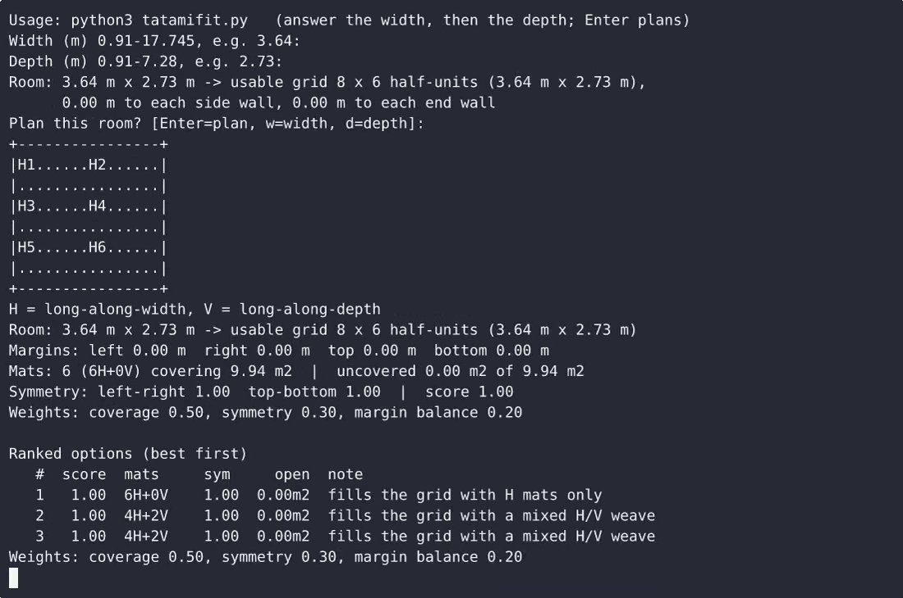
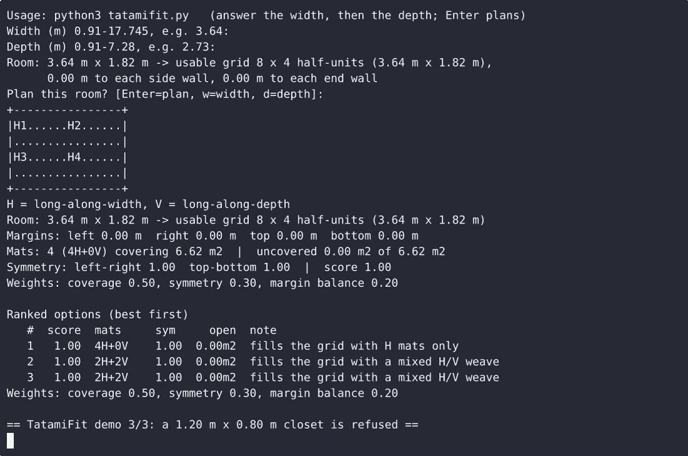

# TatamiFit — Tatami Mat Layout Planner (CLI) — complete Full-stack app command-line tool example app

If you want a self-hosted command-line tool without the vendor lock-in, **TatamiFit — Tatami Mat Layout Planner (CLI)** is ready to run. Built with Full-stack app and Apache-2.0-licensed, TatamiFit — Tatami Mat Layout Planner (CLI) ships complete — one clone, one install command. TatamiFit is a single-file, standard-library-only Python command-line tool that plans tatami mat layouts for a rectangular room. [Open TatamiFit — Tatami Mat Layout Planner (CLI) on cenius.ai](https://cenius.ai/marketplace/p/tatamifit-tatami-mat-layout-planner-cli?ref=gh&utm_campaign=tatamifit-tatami-mat-layout-planner-cli-webapp) to customise it without touching a line of TatamiFit — Tatami Mat Layout Planner (CLI) code.


[](LICENSE)  [](https://cenius.ai)

[](https://cenius.ai/marketplace/p/tatamifit-tatami-mat-layout-planner-cli?ref=gh&utm_campaign=tatamifit-tatami-mat-layout-planner-cli-webapp)

> **▶ [Open & edit in cenius.ai](https://cenius.ai/marketplace/p/tatamifit-tatami-mat-layout-planner-cli?ref=gh&utm_campaign=tatamifit-tatami-mat-layout-planner-cli-webapp)** — one click to an editable workspace: describe changes in plain English, get an instant preview, one-click deploy and host. Modifications made on the platform come with full rebrand & relicense rights.

_Local clone? See [Quick start](#quick-start) below. cenius.ai is the zero-setup path._

## Demo


📽 **[Watch the walkthrough](https://cenius.ai/marketplace/p/tatamifit-tatami-mat-layout-planner-cli?ref=gh&utm_campaign=tatamifit-tatami-mat-layout-planner-cli-webapp)** — plays on cenius.ai · [MP4 file](.github/media/demo.mp4)

## Screenshots

 

## Architecture

Open the repo and you'll find a complete Full-stack app application (18 files). Top-level layout: `tests/`. `install.sh` provisions dependencies and seeds demo data so the app starts with something real to explore. Full setup details: [`INSTALL.md`](INSTALL.md).

## Features

- Interactive room dimension input in metres
- Metric tatami fitting and coverage report
- Aesthetic arrangement suggestions
- Terminal layout diagram and summary

## Quick start

```bash
./install.sh   # installs dependencies + seeds demo data
```

See [`INSTALL.md`](INSTALL.md) for full setup and usage instructions.

## Usage guide

TatamiFit answers one question: *given a rectangular room, which whole-mat tatami layout
looks best?* It prints the winner as an ASCII plan and up to three ranked alternatives.

### 1. One interactive session

```sh
python3 tatamifit.py
```

Type the room width in metres, press Enter, type the depth, press Enter. TatamiFit then
shows the room it accepted and the usable grid it snapped it to:

```
Room: 3.70 m x 2.90 m -> usable grid 8 x 6 half-units (3.64 m x 2.73 m),
      0.03 m to each side wall, 0.085 m to each end wall
Plan this room? [Enter=plan, w=width, d=depth]:
```

- **Enter** plans the room.
- **w** re-asks only the width; **d** re-asks only the depth. At that prompt the previous
  answer is shown in brackets — `Width (m) [3.70]: ` — and a bare Enter keeps it, so a
  typo never costs you the other dimension.

### 2. Piping a room in (scriptable)

Both answers plus the confirm line can come from stdin, which makes the tool pipeline
friendly:

```sh
printf '3.64\n2.73\n\n' | python3 tatamifit.py
echo -e "4.10\n3.20\n\n" | python3 tatamifit.py
```

The last empty line is the confirm. Output goes to stdout, so it can be redirected to a
file or catted into a report. No colour or control characters are ever emitted.

### 3. Reading the plan page

```
+----------------+
|H1......H2......|
|................|
|H3......H4......|
|................|
+----------------+
H = long-along-width, V = long-along-depth
```

_Full guide: [`USAGE.md`](USAGE.md)_

## FAQ

### How do I self-host TatamiFit — Tatami Mat Layout Planner (CLI)?

`git clone` + `./install.sh` gets you a running instance — the install script provisions dependencies and demo data. Full steps live in [`INSTALL.md`](INSTALL.md); nothing external is needed to try it.

### How do I customise TatamiFit — Tatami Mat Layout Planner (CLI)'s branding?

Rebranding is straightforward under the MIT license — change what you want in the source. Or [open it on cenius.ai](https://cenius.ai/marketplace/p/tatamifit-tatami-mat-layout-planner-cli?ref=gh&utm_campaign=tatamifit-tatami-mat-layout-planner-cli-webapp): the platform handles the changes and grants full rebrand rights on the result.

### How can I customize TatamiFit — Tatami Mat Layout Planner (CLI) without editing code?

[cenius.ai](https://cenius.ai/marketplace/p/tatamifit-tatami-mat-layout-planner-cli?ref=gh&utm_campaign=tatamifit-tatami-mat-layout-planner-cli-webapp) handles the implementation. Tell it what you want in everyday words, pick up the updated build. No coding needed.

### Which framework or language does TatamiFit — Tatami Mat Layout Planner (CLI) use?

Powered by Full-stack app. This repo is the real thing — full source, seed data, and all — ready to clone and start up. Highlights include aesthetic arrangement suggestions.

### Does the TatamiFit — Tatami Mat Layout Planner (CLI) license allow commercial use?

Confirmed free for commercial use — MIT terms let you incorporate, resell, or ship it in any product. [LICENSE](LICENSE).

## License & rebranding

Released under the [Apache License 2.0](LICENSE) (© 2026 Cenius AI) — free for personal and commercial use. The Cenius name/logo are trademarks (see NOTICE).

**Need a customized version?** [Remix this app on cenius.ai](https://cenius.ai/marketplace/p/tatamifit-tatami-mat-layout-planner-cli?ref=gh&utm_campaign=tatamifit-tatami-mat-layout-planner-cli-webapp) — modifications made on the platform come with **full rebrand & relicense rights** over your derivative.

## Built with cenius.ai

This entire application — code, design, seeded demo data — was generated on **[cenius.ai](https://cenius.ai)** from a plain-English description.

- 🚀 [Build your own app on cenius.ai](https://cenius.ai)
- 🎛️ [Remix TatamiFit — Tatami Mat Layout Planner (CLI) on the marketplace](https://cenius.ai/marketplace/p/tatamifit-tatami-mat-layout-planner-cli?ref=gh&utm_campaign=tatamifit-tatami-mat-layout-planner-cli-webapp) — open it in a workspace, prompt for changes, and ship your own version.

More open-source apps: [the Cenius-ai catalog](https://github.com/Cenius-ai) · [showcase index](https://github.com/Cenius-ai/showcase)
